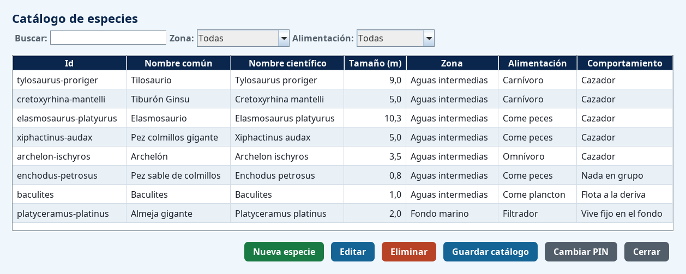
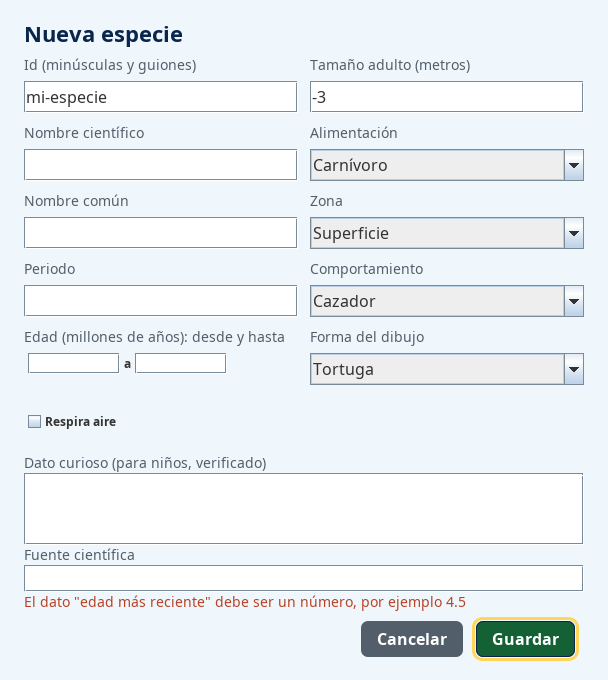

# Ancient Seas: manual del administrador

## 1. Ejecución

Requisito: **Java 17 o superior** y una pantalla gráfica (sin pantalla el programa se cierra con un aviso).

```bash
java -jar ancient-seas-1.0.0.jar [carpeta-de-datos]
```

- Sin argumento, el programa usa la carpeta `data` junto al lugar desde donde se lanzó.
- Con argumento, usa esa carpeta. Así se puede tener una instalación en una memoria USB o copiarla a otro equipo.
- Si la carpeta no se puede crear o escribir, el programa muestra un aviso y se cierra.

### Carpeta de datos

En el primer arranque se crean las carpetas y se copian el catálogo y los ajustes que falten, sin sobrescribir nunca un archivo que ya exista. La carpeta `saves/` empieza vacía y la partida de ejemplo del entregable está aparte, en `build/deliverables/app/examples/sample-save.xml`. Para una demostración, cópiela a `saves/` y use "Continuar partida guardada".

| Archivo o carpeta     | Contenido             | Cuándo aparece            |
| --------------------- | --------------------- | ------------------------- |
| `species.csv`         | Catálogo de especies  | Primer arranque           |
| `settings.properties` | Ajustes del juego     | Primer arranque           |
| `saves/`              | Partidas guardadas    | Primer arranque (vacía)   |
| `exports/`            | Exportaciones XML     | Primer arranque           |
| `ancient-seas.log`    | Registro de actividad | Primer arranque           |
| `admin.properties`    | Huella del PIN        | Primer cambio de PIN      |
| `scores.csv`          | Historial de partidas | Primera partida terminada |

Todas las rutas están dentro de la carpeta de datos (`data/` por defecto).

Para hacer una copia de seguridad basta copiar la carpeta completa.

## 2. Acceso y PIN

En el menú, **Administración del museo** pide un PIN, que al principio es **1234**. Es una protección para que los niños no entren al editor, no una defensa contra alguien con acceso a los archivos.

Para cambiarlo: dentro de la ventana de administración, **Cambiar PIN**. Debe tener de **4 a 12 dígitos** (solo números) y se escribe dos veces. El PIN no se guarda: `admin.properties` contiene una huella con sal (PBKDF2), de modo que copiar la carpeta no revela el número.

Si `admin.properties` se daña, el juego vuelve al PIN 1234 y avisa al personal. Cámbielo en cuanto pueda. Si olvidó el PIN, borre `admin.properties` y vuelva a empezar con 1234.

Cada acceso correcto o incorrecto queda en el registro.

## 3. Ventana del catálogo



La tabla muestra id, nombre común, nombre científico, tamaño, zona, alimentación y comportamiento.

- **Buscar**: filtra por nombre común, nombre científico o id.
- **Zona** y **Alimentación**: filtros combinables con la búsqueda.
- **Nueva especie**: abre el formulario vacío. Si el id ya existe, avisa y deja corregir.
- **Editar**: abre el formulario con la especie elegida. Hay que seleccionar una fila primero.
- **Eliminar**: pide confirmación.
- **Guardar catálogo**: escribe `species.csv`. Es el único momento en que se escribe en el disco.
- **Cambiar PIN** y **Cerrar**.

Los cambios no llegan al juego ni al registro hasta pulsar **Guardar catálogo**. Al cerrar con cambios pendientes se ofrece "Guardar y cerrar", "Cerrar sin guardar" (se descartan) o "Seguir editando". Si el guardado falla, la ventana lo dice y no se cierra.

Si una especie no vivió en la misma época que las demás (por ejemplo, del Cámbrico), la ventana avisa. Se puede guardar: la ficha explicará a los visitantes que vivió en otra época.

Si al cargar el CSV se omitieron filas, aparecen avisos abajo (sección 5). Antes del primer guardado se copia el archivo original como `species-AAAAMMDD-HHMMSS.csv.bak`, para que esas filas puedan recuperarse y corregirse.

El juego necesita la especie del jugador: **`archelon-ischyros` no se puede eliminar ni cambiar de id**. Si falta del catálogo, el botón Jugar avisa que no se puede jugar.

## 4. Formulario de especie



**Todos los campos de texto son obligatorios.** El formulario muestra el primer problema encontrado en rojo y no se cierra hasta que todo sea válido.

| Campo                    | Regla                                             |
| ------------------------ | ------------------------------------------------- |
| Id                       | Minúsculas, números y guiones internos            |
| Nombre científico        | Texto no vacío                                    |
| Nombre común             | Texto no vacío                                    |
| Periodo                  | Texto no vacío                                    |
| Edad (Ma), desde y hasta | Entre 0 y 4000; la reciente, menor que la antigua |
| Tamaño adulto (metros)   | Mayor que 0 y como máximo 35                      |
| Alimentación             | Una de las dietas de la lista siguiente           |
| Zona                     | Superficie, Aguas intermedias o Fondo marino      |
| Comportamiento           | Uno de los comportamientos de la lista siguiente  |
| Forma del dibujo         | Una de las formas de la lista siguiente           |
| Respira aire             | Casilla marcada o no                              |
| Dato curioso             | Texto no vacío, pensado para niños y verificado   |
| Fuente científica        | Texto no vacío (ver sección 10)                   |

- Id: por ejemplo `archelon-ischyros`, sin guiones sueltos al inicio o al final.
- Edad: en millones de años; la edad más reciente debe ser **menor** que la más antigua.
- Dietas: Carnívoro, Come peces, Omnívoro, Come plancton, Filtrador o Come restos.
- Comportamientos: Cazador, Nada en grupo, Flota a la deriva o Vive fijo en el fondo.
- Formas: Tortuga, Mosasaurio, Tiburón, Plesiosaurio, Pez óseo, Pez depredador grande, Amonite enrollado, Amonite de concha recta o Almeja.

Reglas de coherencia con el hábitat:

- Un animal de comportamiento "Vive fijo en el fondo" solo puede estar en la zona "Fondo marino".
- Un animal que respira aire no puede estar en "Fondo marino".
- Un animal que respira aire debe tener el comportamiento "Cazador", porque en el juego solo los cazadores suben a respirar.

Los números aceptan punto o coma decimal.

La **forma** decide qué tipo de presa es el animal y la **alimentación** qué tipos puede comer: juntas determinan quién se come a quién.

## 5. Edición directa de `species.csv`

El archivo también se puede abrir en una hoja de cálculo. Guárdelo como **CSV UTF-8**.

### Columnas

La primera fila es el encabezado (en cualquier orden; deben estar todas):

```text
id,scientificName,commonName,period,minMa,maxMa,lengthMeters,diet,zone,airBreather,behavior,shape,funFact,source
```

Los valores permitidos de cada columna están en el [README](../README.md#speciescsv). `diet`, `zone`, `behavior` y `shape` se escriben con la constante en inglés, no con el nombre que se ve en pantalla:

| Columna    | Constante           | En pantalla             |
| ---------- | ------------------- | ----------------------- |
| `diet`     | `CARNIVORE`         | Carnívoro               |
| `diet`     | `PISCIVORE`         | Come peces              |
| `diet`     | `OMNIVORE`          | Omnívoro                |
| `diet`     | `PLANKTIVORE`       | Come plancton           |
| `diet`     | `FILTER_FEEDER`     | Filtrador               |
| `diet`     | `DETRITIVORE`       | Come restos             |
| `zone`     | `SURFACE`           | Superficie              |
| `zone`     | `MIDWATER`          | Aguas intermedias       |
| `zone`     | `SEAFLOOR`          | Fondo marino            |
| `behavior` | `HUNTER`            | Cazador                 |
| `behavior` | `SCHOOLING`         | Nada en grupo           |
| `behavior` | `DRIFTER`           | Flota a la deriva       |
| `behavior` | `SESSILE`           | Vive fijo en el fondo   |
| `shape`    | `TURTLE`            | Tortuga                 |
| `shape`    | `MOSASAUR`          | Mosasaurio              |
| `shape`    | `SHARK`             | Tiburón                 |
| `shape`    | `PLESIOSAUR`        | Plesiosaurio            |
| `shape`    | `BONY_FISH`         | Pez óseo                |
| `shape`    | `PREDATORY_FISH`    | Pez depredador grande   |
| `shape`    | `AMMONITE`          | Amonite enrollado       |
| `shape`    | `STRAIGHT_AMMONITE` | Amonite de concha recta |
| `shape`    | `CLAM`              | Almeja                  |

Las reglas de la sección 4 (id, edades, tamaño, hábitat) se aplican también a cada fila.

### Separadores, decimales y comillas

- El separador puede ser `,` o `;`. Se detecta en la fila de encabezado.
- Con `;` se aceptan decimales con coma (`4,5`). Con `,` los decimales deben llevar punto (`4.5`).
- Los textos con el separador, saltos de línea o comillas dentro deben ir entre comillas dobles, y una comilla interna se duplica (`""`).
- Una comilla que se abre y nunca se cierra hace inutilizable el archivo.
- Se admite la marca BOM de UTF-8 al inicio.

Cuando el catálogo se guarda desde la ventana de administración, el archivo se reescribe siempre en forma estándar: separador `,`, decimales con punto y columnas en el orden de arriba. Cualquier columna extra que haya agregado se pierde en ese momento.

### Qué pasa con las filas malas

| Situación                                   | Resultado                   |
| ------------------------------------------- | --------------------------- |
| Número de campos distinto al del encabezado | Se omite la fila            |
| Dato inválido                               | Se omite la fila            |
| Id repetido                                 | Se conserva solo la primera |
| Columnas desconocidas                       | Se ignoran y se avisa       |
| Faltan columnas obligatorias                | Archivo inutilizable        |
| Archivo vacío o ilegible                    | Archivo inutilizable        |
| Comillas sin cerrar                         | Archivo inutilizable        |

Un dato es inválido si tiene un número mal escrito, una constante desconocida o incumple una regla. Con un id repetido se omiten las filas siguientes.

Cada fila omitida se informa con su número (`Fila 7: ...`) en la lista de avisos de la ventana de administración. Al iniciar, si hubo cualquier problema de datos, se muestra un aviso general para el personal y el juego sigue funcionando.

Si el archivo completo es inutilizable, el juego usa su **catálogo original incluido** y lo dice en esos avisos. Si tampoco este se pudiera leer, el catálogo queda vacío.

Los cambios hechos al CSV se leen al iniciar: reinicie el programa para verlos.

## 6. Ajustes (`settings.properties`)

Se editan desde **Ajustes** en el menú o a mano. Un valor ausente toma el valor normal; uno inválido se reemplaza por el normal. Al iniciar aparece un aviso general y el detalle queda en `ancient-seas.log`.

| Clave            | Valores                          | Normal       |
| ---------------- | -------------------------------- | ------------ |
| `difficulty`     | `EASY`, `NORMAL`, `HARD`         | `NORMAL`     |
| `creatureCount`  | Entero de 15 a 90                | 45           |
| `eventFrequency` | `LOW`, `NORMAL`, `HIGH`          | `NORMAL`     |
| `playerName`     | De 1 a 20 caracteres             | `Explorador` |
| `reducedMotion`  | `true`, `false`                  | `false`      |
| `interfaceSize`  | `NORMAL`, `LARGE`, `EXTRA_LARGE` | `NORMAL`     |

En pantalla las dificultades se llaman Fácil, Normal y Difícil, y la frecuencia de eventos Pocos, Normal y Muchos. Las líneas que empiezan con `#` son comentarios. Si los ajustes no se pueden guardar, el juego los usa igual hasta cerrarse y avisa.

`LARGE` equivale al 125 % y `EXTRA_LARGE` al 150 %. El tamaño de la interfaz se aplica al volver a abrir el juego; para visitantes con baja visión conviene `LARGE`.

## 7. Puntuaciones (`scores.csv`)

Se agrega una línea al terminar cada partida, con estas columnas:

```text
playerName,score,stage,outcome,durationSeconds,difficulty,playedAt
```

Las líneas ilegibles se omiten. Al iniciar aparece un aviso general y el detalle queda en `ancient-seas.log`. Para reiniciar el historial basta con borrar o renombrar el archivo con el programa cerrado. La tabla de **Mejores puntuaciones** muestra las 10 mejores.

## 8. Registro (`ancient-seas.log`)

Es un archivo de texto UTF-8 al que se agregan líneas con fecha, nivel y mensaje. Registra:

- Inicio y cierre de la aplicación, y la carpeta de datos usada.
- Archivos de ejemplo creados en el primer arranque.
- Problemas de datos encontrados al iniciar.
- Partidas iniciadas (con nombre y dificultad), reanudadas y terminadas (resultado, puntos y etapa).
- Partidas guardadas y exportaciones realizadas, con la ruta del archivo.
- Cambios de ajustes.
- Accesos a administración, PIN incorrecto y cambio de PIN.
- Cambios del catálogo (especie agregada, editada o eliminada) y guardados del catálogo.
- Errores, con el detalle técnico.

El archivo crece sin límite: archívelo o bórrelo de vez en cuando, con el programa cerrado.

## 9. Exportaciones y partidas guardadas

### Exportaciones XML (carpeta `exports/`)

- **Mejores puntuaciones > Exportar historial** crea `puntuaciones-AAAAMMDD-HHmmss-SSS.xml` (SSS son los milisegundos) con el historial completo.
- En la ventana de resultados, **Exportar informe** crea `expedicion-AAAAMMDD-HHmmss-SSS.xml` con el resultado de esa partida y el censo de especies.

Al terminar, el programa muestra la ruta completa del archivo.

### Partidas guardadas (carpeta `saves/`)

El botón **Guardar** de la pantalla de juego crea un archivo `partida-AAAAMMDD-HHmmss-SSS.xml`, uno por cada guardado. **Continuar partida guardada** carga el **más reciente** (por fecha de modificación) de la carpeta.

Si después se cambia el comportamiento, tamaño, alimentación, zona, forma o respiración de una especie que aparece en una partida guardada, esa partida ya no se puede continuar y "Continuar" prueba la siguiente. Cambiar textos (nombres, dato curioso, fuente) no las afecta.

Si el archivo está dañado o no es compatible, el juego lo explica y ofrece empezar una partida nueva.

## 10. Rigor científico

- **Toda especie nueva debe tener una fuente verificable** (artículo, base de datos paleontológica, libro o museo), escrita en el campo "Fuente científica".
- **Todo dato obtenido con un asistente de inteligencia artificial debe contrastarse con una fuente confiable antes de entrar al catálogo.** Estos asistentes pueden inventar nombres, edades, tamaños y citas con apariencia convincente.
- Revise especialmente el rango de edad, el tamaño adulto, la dieta y la zona donde vivía.
- El dato curioso debe poder comprobarse en la misma fuente.

Las fuentes de las especies actuales están en `docs/fuentes.md`. Agregue allí las de cada especie nueva.

## 11. Solución de problemas

| #   | Problema                                          |
| --- | ------------------------------------------------- |
| 1   | El programa no abre y no muestra nada             |
| 2   | "No se pudo preparar la carpeta de datos"         |
| 3   | Aviso "Se encontraron N datos con problemas"      |
| 4   | Una especie nueva no aparece                      |
| 5   | Aviso de que se usa el catálogo original          |
| 6   | Decimales mal leídos (por ejemplo, 4,5 rechazado) |
| 7   | Las letras con tilde salen mal                    |
| 8   | "Falta la Archelon en el catálogo"                |
| 9   | "No se pudo guardar el catálogo"                  |
| 10  | PIN olvidado                                      |
| 11  | "No se pudo guardar la partida"                   |
| 12  | "Todavía no hay partidas guardadas"               |
| 13  | La partida guardada no abre                       |
| 14  | Los ajustes cambian solos al iniciar              |
| 15  | "Algo salió mal en el océano"                     |

Qué hacer en cada caso:

1. Revise que haya pantalla gráfica y Java 17 o superior (`java -version`).
2. Compruebe que la ruta exista y que se pueda escribir en ella.
3. Si el problema es de `species.csv`, entre a Administración del museo y corrija las filas de la lista de avisos. Los problemas de ajustes, historial o PIN se detallan en `ancient-seas.log`.
4. Su fila tenía un error y se omitió; revise el aviso con su número de fila. Si editó el CSV a mano, reinicie el programa.
5. `species.csv` es inutilizable: encabezado incompleto, archivo vacío o comillas sin cerrar. Corríjalo o restaure una copia.
6. Con separador `,` use punto decimal; con `;` se acepta la coma.
7. Guarde el CSV como UTF-8.
8. Agregue o restaure la especie `archelon-ischyros`.
9. Cierre el archivo si está abierto en una hoja de cálculo y vuelva a guardar.
10. Con el programa cerrado, borre `admin.properties`; el PIN vuelve a ser 1234.
11. Revise que `saves/` exista y tenga espacio y permisos.
12. No hay archivos `.xml` en `saves/`.
13. Puede estar dañada o ser de una versión incompatible; empiece una nueva y retire el archivo de `saves/`.
14. Un valor inválido en `settings.properties` se reemplazó por el normal; corríjalo.
15. La simulación se detuvo; el detalle está en `ancient-seas.log`. Anote la hora y revise el registro.
