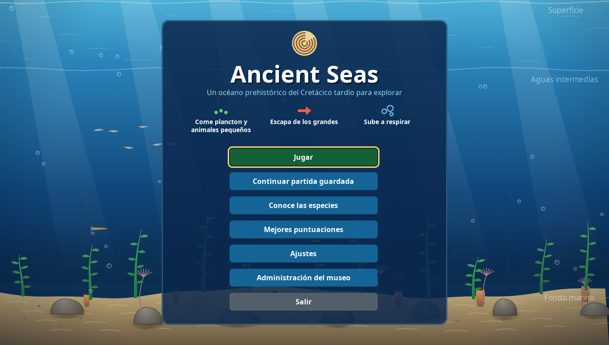
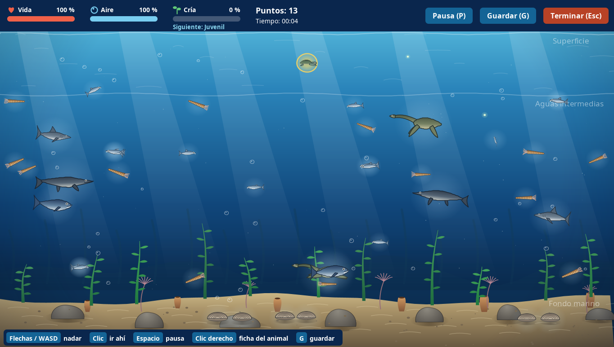

# Ancient Seas: manual del visitante

## De qué trata

Eres una pequeña **Archelon**, una tortuga marina gigante, y nadas en un mar del final del Cretácico, hace unos 80 millones de años. Tu meta es **comer y crecer**: pasas de Cría a Juvenil, luego a Subadulto y por fin a Adulto. Si llegas a adulta, ganas.

Pierdes si la barra de **Vida** llega a cero. Eso pasa si te muerden animales más grandes o si te quedas sin **Aire** bajo el agua, porque las tortugas respiran en la superficie.

## Cómo se juega

Arriba ves tus tres barras (**Vida**, **Aire** y la de tu **etapa**, por ejemplo Cría), tus puntos y el tiempo. Debajo de la barra de etapa aparece la que sigue.

| Qué quieres hacer         | Cómo                                            |
| ------------------------- | ----------------------------------------------- |
| Nadar                     | Flechas o teclas W, A, S, D                     |
| Ir hacia un punto         | Clic izquierdo en el mar                        |
| Pausar o seguir           | Espacio, P o el botón "Pausa (P)"               |
| Ver la ficha de un animal | Clic derecho sobre él; el juego se detiene      |
| Terminar                  | Escape o el botón Terminar (pregunta antes)     |
| Seguir otro día           | G; luego "Continuar partida guardada"           |
| Moverte por el menú       | Flechas; Enter elige el botón de borde amarillo |

## Consejos

- Los depredadores con hambre te persiguen. Si ya comieron, te ignoran.
- Los mosasaurios y los plesiosaurios también necesitan aire, así que suben a la superficie.
- Después de una mordida estás a salvo 2 segundos: aparece un escudo azul alrededor de tu tortuga.
- Si el aire baja mucho, verás "¡Sube a respirar!" bajo la barra de Aire. Al comer aparece "+N" sobre tu tortuga y al crecer, un anillo verde.
- Solo puedes comer animales mucho más pequeños que tú.
- El plancton (puntos verdes) siempre es comida segura.
- El océano cambia: puede haber corrientes, agua fría (todos nadan más lento), lluvia de comida o la llegada de un depredador.

## Otras opciones del menú

- **Conoce las especies**: fichas de todos los animales del mar.
- **Mejores puntuaciones**: la tabla de los mejores exploradores.
- **Ajustes**: tu nombre, la dificultad (Fácil, Normal o Difícil), el número de criaturas (de 15 a 90) y los eventos del océano (Pocos, Normal o Muchos).
  - **Movimiento reducido**: quita los rayos de luz, las burbujas y otros movimientos decorativos, para quien se marea o se distrae con ellos. Los animales siguen moviéndose porque son el juego.
  - **Tamaño de la interfaz**: Normal, Grande (125 %) o Muy grande (150 %). Agranda textos, botones e indicadores; se aplica la próxima vez que abras el juego.
- **Administración del museo**: solo para el personal, pide un PIN.

Al terminar verás tus puntos, la etapa que alcanzaste y el tiempo. Puedes usar **Exportar informe** o **Jugar otra vez**.

## Para docentes

Pida a los estudiantes que, durante la partida, abran con clic derecho la ficha de varios animales y anoten qué come cada uno y quién se lo come. El plancton alimenta a animales pequeños, estos a los peces y cefalópodos, y estos a los grandes reptiles marinos: esa es una cadena alimentaria. Durante el juego se ve la cadena completa: la Archelon crece comiendo, pero también es presa de los más grandes. Al terminar, el informe de la expedición lista cuántos animales de cada especie había, lo que sirve para comparar poblaciones en la discusión en clase.
